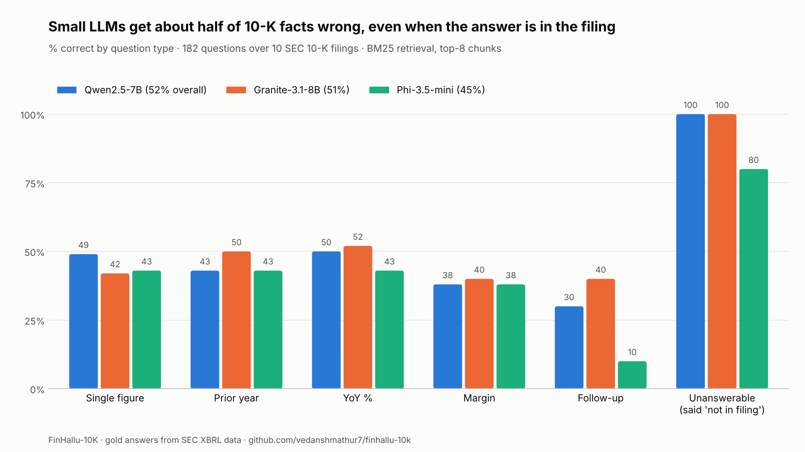

# FinHallu-10K

**How often do LLMs get financial facts wrong when answering from a company's 10-K?**

182 questions over the latest annual reports of 10 US public companies (Apple, Microsoft, NVIDIA, JPMorgan, Exxon, J&J, Walmart, Caterpillar, Coca-Cola, Netflix). Every gold answer comes from the company's own XBRL-tagged financial data on SEC EDGAR — not hand-typed, not LLM-generated.

Models answer the way most production "chat with your documents" apps do: BM25 retrieval over the filing, top-8 chunks, one prompt.

## Question types

| Type | n | What it tests |
|---|---|---|
| lookup | 76 | One reported figure (revenue, net income, assets, EPS, cash…) |
| prior_year | 30 | Last year's comparative figure — catches year confusion |
| yoy | 30 | % change between years — retrieval + arithmetic |
| ratio | 16 | Net / operating margin — two facts combined |
| multiturn | 10 | "And the year before?" follow-up — context carry-over |
| trap | 20 | Unanswerable (a future year) — does the model invent a number? |

## Failure taxonomy

Every wrong answer gets exactly one label: `fabricated` (number for an unanswerable question), `wrong_year`, `scale_error` (thousands vs millions), `sign_error`, `wrong_value`, `false_refusal`, `no_answer`. Grading is deterministic and precision-aware (a figure must match to the last digit the model states) and validated against human labels with Cohen's kappa (`scripts/agreement.py`).

## Run it

```bash
pip install -r requirements.txt
make test                                   # unit tests + dry run, no API calls
export SEC_USER_AGENT="Your Name you@email.com"
make filings                                # downloads the 10 filings from EDGAR (~1 min)
export OPENROUTER_API_KEY=...  OPENAI_API_KEY=...
make run                                    # all models in models.yaml
make report                                 # results/results_summary.md + results_chart.png
```

Free option: run open models on a Kaggle T4 with vLLM (`vllm serve Qwen/Qwen2.5-7B-Instruct`) and point a `models.yaml` entry at `http://localhost:8000/v1`.

## Results (run of 13 Oct 2026)

Three open models, run locally on a Kaggle 2x T4 (fp16, greedy decoding, BM25 top-8, 300-token answer limit).



| Model | Overall | lookup | prior year | YoY % | margin | follow-up | unanswerable (abstained) |
|---|---|---|---|---|---|---|---|
| Qwen2.5-7B-Instruct | **52%** | 49% | 43% | 50% | 38% | 30% | 100% |
| Granite-3.1-8B-Instruct | **51%** | 42% | 50% | 52% | 40% | 40% | 100% |
| Phi-3.5-mini-instruct | **45%** | 43% | 43% | 43% | 38% | 10% | 80% |

**Failure taxonomy (count of wrong answers)**

| Model | fabricated | wrong year | scale error | wrong value | false refusal | no answer |
|---|---|---|---|---|---|---|
| Qwen2.5-7B | 0 | 0 | 4 | 20 | 60 | 4 |
| Granite-3.1-8B | 0 | 0 | 5 | 54 | 24 | 0 |
| Phi-3.5-mini | 4 | 1 | 7 | 53 | 32 | 3 |

Granite: 12 of 182 calls ran out of GPU memory and are excluded (not counted as wrong).

### What we found

1. **About half of the answers are wrong, even though every answer is in the filing.** The best small model gets 52%.
2. **The dominant error is a real number from the wrong table, not an invented one.** Example: all three models report Apple's cash as **$28,267M**. That is the "Cash" row of a fair-value table; the balance sheet says **$35,934M**. Two models give Apple's operating income as **$67,656M**, a segment figure, instead of the consolidated **$133,050M**. Plausible-looking, sourced, and wrong.
3. **Models fail in different directions.** Qwen refuses rather than guesses (60 false refusals, 0 fabrications). Phi fabricates a figure on 20% of unanswerable questions. Granite answers more but is wrong more often (54 wrong values).
4. **Follow-up questions are the weakest point.** "And the year before?" drops Phi to 10%.

Grading was audited by hand: every non-correct answer is printed by `scripts/regrade.py`. Two answer-key values were checked against the filing text (Apple cash and operating income) and confirmed.

## Limitations

- 10 companies, one filing each; BM25 only (no embeddings or rerankers) — this measures a common baseline, not the best possible system.
- Gold values come from XBRL tags; where a company presents a figure differently in the text, the grader accepts rounding to the precision the model states ("$416.2 billion") but not definitional differences. Disagreements found during human labelling are listed by `scripts/agreement.py score`.
- Answers are capped at 300 tokens; a few step-by-step answers are cut off before the final number and graded `no_answer` (4 for Qwen).
- Small presentation differences can count as wrong (e.g. Caterpillar cash $9,986M in an answer vs $9,980M in XBRL).
- Only small open models (3.8B–8B) so far; frontier API models are next.
- Bank "revenue" (JPM) is the XBRL `Revenues` total, which can differ from managed-basis figures in the narrative.

## Want this for your product?

I build domain-specific eval suites for AI teams: failure taxonomy, graded test cases, a validated judge, CI regression runs. — Vedansh Mathur · [LinkedIn](https://www.linkedin.com/in/vedansh-mathur-86767a300) · vedanshmathur007@gmail.com
